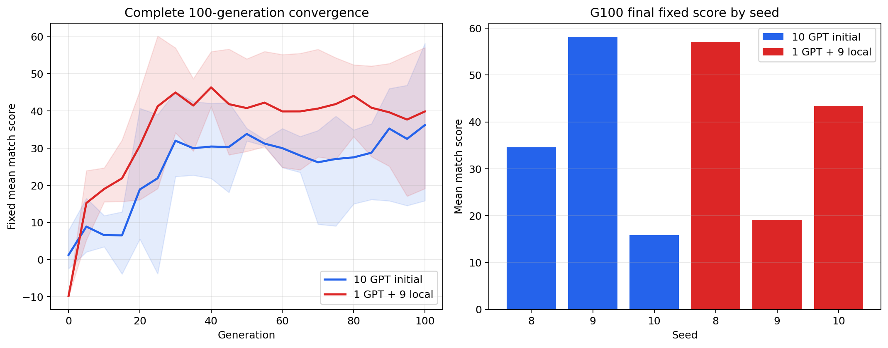
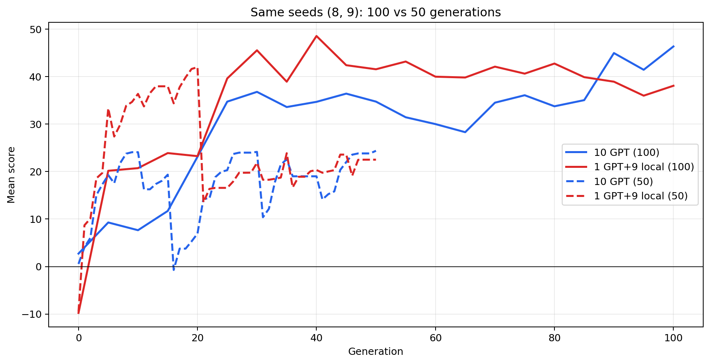
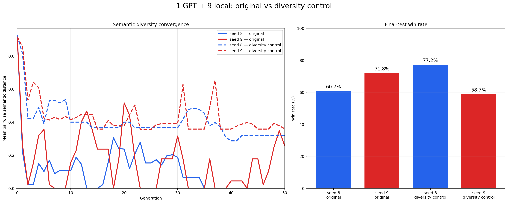

# 1113 實驗比較：100 代、50 代與 diversity control

本報告把三組不同問題分開比較。`search score` 是演化期間的 self-play
`game_performance`；`final score` 則是固定 10-opponent × 3-map × 10-game ×
2-side protocol 的 benchmark，兩者不混用。

## 一、完整 100 代：10 GPT initial vs 1 GPT + 9 local

兩個 treatment 都使用相同 framework bundle、population 10、seeds 8、9、10，
完整演化 100 代；差別只在 generation 0：

- **10 GPT initial**：十個 initial genomes 都由 GPT 選擇。
- **1 GPT + 9 local**：index 0 使用 frozen GPT genome，其餘 9 個使用 local genomes。

完整 100 代 fixed benchmark 的 G100 結果：

| Treatment | Seed 8 | Seed 9 | Seed 10 | 三 seed 平均 |
|---|---:|---:|---:|---:|
| 10 GPT initial | 34.56 | 58.19 | 15.84 | 36.20 |
| 1 GPT + 9 local | 57.06 | 19.12 | 43.40 | 39.86 |

這一組完整 100 代結果顯示：10 GPT initial 的 G0 起點較高，但後續表現有明顯
seed variance；沒有一致的 seed-level winner。

來源：[100 代 convergence report](../../reports/20261107_all_gpt_vs_one_gpt_convergence.md)

## 二、相同 seed 的 100 代 vs 50 代：四條收斂線

這張圖只取兩個版本都具有的 seed 8、9，避免把 seed 10 的 100 代結果和沒有
對應 50 代結果的資料混在一起。實線是 100 代 fixed benchmark mean score，
虛線是 50 代 search population best score。

50 代直接比較的 final-test 結果：

| Treatment | Seed 8 W/D/L | Seed 9 W/D/L | 平均勝率 |
|---|---:|---:|---:|
| 10 GPT initial | 439/9/152 | 327/20/253 | 63.83% |
| 1 GPT + 9 local | 364/9/227 | 431/0/169 | 66.25% |

來源：[1113 原始 50 代資料](all_candidate_fixed_convergence/all_candidate_results.csv)、
[50 代 comparison config/report](../../configs/experiments/1108_gpt_vs_local_50x10_seed8_9/RESULTS.md)。

## 三、diversity control：已完成 seed vs 原始 1 GPT + 9 local

後續在 self-play survivor selection 加入兩個 diversity seats，以 behavioral
distance 對 fitness leaders 做 max-min 選擇。這不是新的初始化 treatment；它仍是
`1 GPT + 9 local`，只是 survivor selection contract 已改變。

比較對象：

- **Original**：1109 的 1 GPT + 9 local，seed 8、9。
- **Diversity control**：1111 的 1 GPT + 9 local，seed 8、9；目前兩個已完成。

左圖是每一代 population 內 45 個 candidate pair 的平均 semantic distance；實線為
原始版本，虛線為 diversity control。右圖是相同兩個已完成 seed 的 final-test
勝率。

| Seed | Original final W/D/L | Diversity-control final W/D/L | Original win rate | Diversity-control win rate |
|---:|---:|---:|---:|---:|
| 8 | 364/9/227 | 463/11/126 | 60.67% | 77.17% |
| 9 | 431/0/169 | 352/10/238 | 71.83% | 58.67% |

兩個已完成 seed 合計：

- Original：795/9/396，勝率 66.25%
- Diversity control：815/21/364，勝率 67.92%

目前只能說兩個 seed 的 aggregate 略有提升；seed 8 改善、seed 9 退步，仍不能
下 diversity control 穩定提升的結論。1111 的 seed 10 尚未完成，seed 11、12
尚未開始。

## 四、三個版本的 opponent-level final-test 表

以下均為跨已完成 seeds 的 aggregate，欄位順序為 `W/D/L/E`。100 代兩組取
G100 fixed final-test；diversity-control 取 1111 已完成 seed 8、9 的 final-test。
每個 seed 每個 opponent 有 60 場，因此：100 代表格每列共 180 場，diversity
control 表格每列共 120 場。

### 4.1 完整 100 代：10 GPT initial（seeds 8、9、10）

| Opponent | W | D | L | E |
|---|---:|---:|---:|---:|
| PassiveAI | 180 | 0 | 0 | 0 |
| RandomAI | 180 | 0 | 0 | 0 |
| RandomBiasedAI | 180 | 0 | 0 | 0 |
| LightRush | 110 | 0 | 70 | 0 |
| HeavyRush | 150 | 0 | 30 | 0 |
| WorkerRush | 140 | 0 | 40 | 0 |
| AllInBot | 122 | 0 | 58 | 0 |
| Mayari | 57 | 12 | 111 | 0 |
| COAC | 58 | 3 | 119 | 0 |
| TMA | 20 | 0 | 160 | 0 |

### 4.2 完整 100 代：1 GPT + 9 local（seeds 8、9、10）

| Opponent | W | D | L | E |
|---|---:|---:|---:|---:|
| PassiveAI | 180 | 0 | 0 | 0 |
| RandomAI | 180 | 0 | 0 | 0 |
| RandomBiasedAI | 180 | 0 | 0 | 0 |
| LightRush | 120 | 0 | 60 | 0 |
| HeavyRush | 160 | 0 | 20 | 0 |
| WorkerRush | 120 | 10 | 50 | 0 |
| AllInBot | 133 | 23 | 24 | 0 |
| Mayari | 31 | 10 | 139 | 0 |
| COAC | 71 | 0 | 109 | 0 |
| TMA | 40 | 0 | 140 | 0 |

### 4.3 50 代 diversity-control：1 GPT + 9 local（已完成 seeds 8、9）

| Opponent | W | D | L | E |
|---|---:|---:|---:|---:|
| PassiveAI | 120 | 0 | 0 | 0 |
| RandomAI | 119 | 1 | 0 | 0 |
| RandomBiasedAI | 120 | 0 | 0 | 0 |
| LightRush | 110 | 0 | 10 | 0 |
| HeavyRush | 120 | 0 | 0 | 0 |
| WorkerRush | 90 | 0 | 30 | 0 |
| AllInBot | 77 | 2 | 41 | 0 |
| Mayari | 18 | 11 | 91 | 0 |
| COAC | 41 | 7 | 72 | 0 |
| TMA | 0 | 0 | 120 | 0 |

## Run 對照

| 比較 | Treatment | Seed | Run |
|---|---|---:|---|
| 100 代 | 10 GPT initial | 8 | `20261105_153135_880565` |
| 100 代 | 10 GPT initial | 9 | `20261106_072846_805117` |
| 100 代 | 10 GPT initial | 10 | `20261107_135945_086651` |
| 100 代 | 1 GPT + 9 local | 8 | `20261101_211038_286628` |
| 100 代 | 1 GPT + 9 local | 9 | `20261102_131719_965893` |
| 100 代 | 1 GPT + 9 local | 10 | `20261103_043534_423377` |
| 50 代 | 10 GPT initial | 8 | `20261108_144319_755348` |
| 50 代 | 10 GPT initial | 9 | `20261109_000650_966551` |
| 50 代 | 1 GPT + 9 local | 8 | `20261109_072720_479146` |
| 50 代 | 1 GPT + 9 local | 9 | `20261109_150205_472817` |
| Diversity control | 1 GPT + 9 local | 8 | `20261111_131257_292954` |
| Diversity control | 1 GPT + 9 local | 9 | `20261112_011300_617215` |
