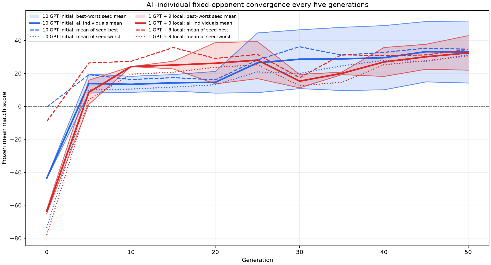

# 1113 全體個體固定對手收斂比較

每 5 代評估每個 seed 的全部 runnable individuals；兩種初始化方法使用固定 opponents、maps、tick limits 與 paired seed stream。

原始個體結果：[all_candidate_results.csv](all_candidate_fixed_convergence/all_candidate_results.csv)

彙總統計：[five_statistic_summary.csv](all_candidate_fixed_convergence/five_statistic_summary.csv)

圖中實線是所有個體平均；虛線是各 seed 最佳／最差個體的平均；色塊範圍是最佳 seed 平均到最差 seed 平均。
