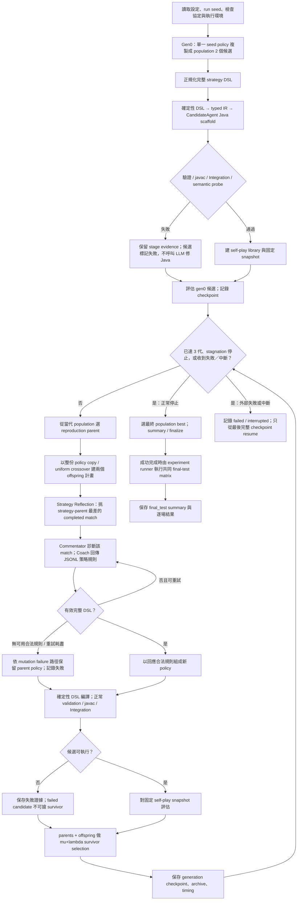

# EAGLE deterministic DSL + GPU-parallel execution：版本證據報告

資料截點：2026-10-14，程式版本至 `94ab1869`。時區：Asia/Taipei。這份報告依現行程式與設定重建方法；未找到該三次正式搜尋的結果，因此不報告搜尋勝率、適應度或代際耗時。

## 範圍與基準

主線設定是 [ministral3_8b_deterministic_dsl_3x2_seed8_3runs.yaml](../../configs/experiments/1014_deterministic_dsl_3x2_seed8_3runs/ministral3_8b_deterministic_dsl_3x2_seed8_3runs.yaml)。本報告以 2026-10-13 workflow deck 所記載的程式版本 `1fa6662e` 作方法基準；deck 由 `67fbd5b7` 提交，主線是 `llm` materialization、`inherited_genotype`、self-play、seed 7、3 runs、population 2、3 代。deck 明確說明它解釋程式流程，不是新實驗量測。來源：[workflow_explained.md](../../Meeting/20261013_current_workflow/workflow_explained.md)；[content.json](../../Meeting/20261013_current_workflow/content.json)。

| 日期 / revision | 變更前 → 變更後 | 影響與觀察 |
| --- | --- | --- |
| 2026-10-14 / `37d5ec2e` | 新增確定性 DSL→Java compiler、typed IR、canonical scaffold 與 golden/hash contract。 | Compiler 功能變更；不等於已跑目標三次實驗。來源：`eagle/generation/dsl_java_compiler.py`、`tests/test_dsl_java_compiler.py`。 |
| 2026-10-14 / `9500d3c1` | 將 compiler 接入候選初始化、offspring、evaluation、artifact、resume 流程，加入 `deterministic_dsl` 選項。 | Active genotype 限定完整策略 DSL；正常 validation、javac、Integration、semantic probe、matches 繼續；無 LLM Java fallback。來源：`eagle/config.py`、`eagle/evaluation/decoding.py`、`eagle/evolution/offspring.py`、`eagle/evolution/resume.py`。 |
| 2026-10-14 / `195ec5d3` | 更新架構文件、設定說明及測試契約，描述 deterministic DSL materialization。 | 文件／契約記錄，不是 compiler 或 runtime feature commit，也不是目標實驗結果。來源：`docs/eagle_architecture_spec.md` §15、`docs/testing/test_contracts.md`。 |
| 2026-10-14 / `dbaeb7c2` | 無此專用設定 → 新增 seed 8、3 repeats、3 代、population 2 的 deterministic DSL self-play YAML。 | 設定已追蹤；沒有對應正式 run 證據。來源：上述 YAML。 |
| 2026-10-14 / `2585ce0e` | 批次 replicate 不易按槽續跑 → `experiment.yaml` 保存有序 replicate slots、每槽有效 seed，支援 folder batch resume。 | 這是恢復與追蹤能力，不是實驗結果。此設定資料夾目前只有單一 YAML，沒有 `experiment.yaml` 或 batch run 記錄。來源：`eagle/experiment.py`、`eagle/evolution/resume.py`、`docs/operations/running_eagle.md`。 |
| 2026-10-14 / `c401d99a` | 執行資源與併發曾可由舊 config 覆寫 → GPU layers 999、model threads 8、llama-server slots 2、LLM phase workers 2、match workers 10 固定；GPU preflight 和完整 offload log 證據成為必要條件。 | LLM 與 match 併發結果按輸入／canonical match 次序回傳；GPU 不可用或 offload 不完整時停止，不退回 CPU。來源：`eagle/execution.py`、`eagle/runtime/processes.py`、`docs/eagle_architecture_spec.md` §3–4。 |
| 2026-10-14 / `6dee5d4f` | Coach 類策略輸出以整份 JSON 為主 → 改為每行一條目標化 JSONL 規則，按實體行解析。 | 為規則級驗證奠基；有效規則保持輸入行順序。來源：`eagle/strategy_dsl.py`、`eagle/operators/strategy.py`。 |
| 2026-10-14 / `4f04c901` | JSONL 任一規則失敗可能使整次回應失敗 → 獨立驗證並保留合法規則，丟棄 malformed／語意不合法整條規則。 | 非空合法子集可成功；零條合法規則才失敗並走有界重試。沒有對應三次正式結果。來源：`eagle/strategy_dsl.py`、`eagle/operators/strategy.py`、`docs/eagle_architecture_spec.md` §6。 |
| 2026-10-14 / `b536fd42` | 通用 Code Reflection／Java generation 提示 → 提示明確描述 DSL-policy 到完整 Java phenotype 的語意。 | 僅適用 `llm` materialization；不能推論為 deterministic DSL 實驗中的有效操作。來源：`prompts/code_reflection.txt`、`prompts/java_generation.txt`、`prompts/prompt_reflection.txt`。 |
| 2026-10-14 / `94ab1869` | llama.cpp core INFO 被 verbosity 3 隱藏，GPU 嚴格驗證看不到 offload 行 → server 使用 `--log-verbosity 4`，並固定 `--fit off`。 | 使用者提供的 remote log 顯示 RTX 5080/CUDA 可用，但 verbosity 3 下 GPU strict check 在 gen0 前失敗。verbosity 4 修正是可觀測性與啟動設定修復，不能當成搜尋成功證據。來源：`eagle/runtime/config.py`、`eagle/runtime/processes.py`、`tests/test_runtime_workflow.py`。 |

## 設定與完整搜尋流程

設定摘要：`java_materialization_mode=deterministic_dsl`、compiler `eagle-dsl-java-v1`、seed list `[8]`、`runs=3`、3 個演化世代、population size 2、Worker Rush seed policy、self-play、static operator、temperature 0。依 replicate 規則，這代表 seed 8 重複三次，各自獨立 run directory；不是 seed 8/9/10。Generation 0 只有一份 seed policy，但 deterministic DSL 初始化會將它複製至 population size，因此建立兩個不同 ID、相同 policy 的初始候選；之後每代建立兩個 offspring。來源：YAML；`eagle/operators/initialization.py`；`eagle/config.py`；`eagle/experiment.py`。

操作邊界：

- **啟用的 genotype 與初始化：** deterministic mode 的 active genotype 只有完整 `strategy_prompt`；`generation_prompt`、inherited Java、Java source gate、Code Reflection、Prompt Reflection、Java Generation 與 compile-repair LLM 都不啟用。每個 policy 經 `eagle-strategy-dsl-v1` 正規化，編譯器輸出完整 Java phenotype；相同 policy/compiler/scaffold 應 byte-identical。compiler/validator/javac 失敗保留階段證據，沒有 LLM fallback。來源：`docs/eagle_architecture_spec.md` §15；`eagle/generation/dsl_java_compiler.py`；`eagle/generation/backend.py`。
- **父代與變異：** 每個 offspring slot 先按 seeded selection 選繁殖來源；可整份複製或在兩個來源間做 uniform policy crossover，不做 rule-level crossover。Strategy mutation 按設定機率執行；此 YAML mutation rate=1.0、只有 Strategy operator 機率為 1。反思使用記錄的 `strategy_parent_id`，挑其已完成 matches 中最低有限 `performance` 的一場；缺少有限分數時以 loss/draw/win 的固定 fallback 值排序，tie 依 stable match ID。Commentator 對該場診斷，Coach 收到該診斷及整體 evaluation summary。來源：`eagle/evolution/offspring.py`、`eagle/operators/strategy.py`、`docs/eagle_architecture_spec.md` §6。
- **JSONL、retry 與失敗：** Coach 的每條 JSONL 實體行獨立解析，整條規則需符合封閉 DSL schema；只保留有效且按原始行序排列的規則，不在拒絕的 rule subtree 內修補欄位。非空合法子集可以形成 policy；零條合法規則走具證據的有限重試，最後沒有合法回應就保留 parent policy 並記錄 mutation 失敗。LLM transport/server exception 可能中止該 phase，使 run failed/interrupted；不保證都轉成正常候選。來源：`eagle/strategy_dsl.py`、`eagle/operators/strategy.py`、`eagle/evolution/offspring.py`。
- **Evaluation opponents：** gen0 的兩個相同 Java phenotype 候選各自參與 bootstrap evaluation context，十個 self-play slots 循環分配這兩個候選 ID；每候選每代 10 slots × 3 maps × 3 rounds/map × 2 sides = 180 matches，地圖 tick limits 為 1500、3000、4000。評估後，run-local library 依候選順序追加可執行個體，以 candidate ID、Java hash 及可用完整 semantic signature 去重，超容量時從最舊端淘汰。於 gen0，兩候選的 Java hash 相同，故 library 留一個 source，snapshot 將它循環填滿 `self_play_000`…`self_play_009`。兩種 context 不同，因此 gen1 先重評 parent phenotype 到 snapshot context；gen1 offspring 與 gen1 survivors 已使用此 context，gen2–3 只在 context 相同時重用 cached parent fitness。Refresh 每 5 代執行；這個三代設定不會觸發下一次 library refresh。一般刷新時，按 FIFO 順序最多取十個來源；若 library 超過十個，以 `epoch × source_count mod library_count` 決定窗口起點，再循環選出窗口，來源不足十個則循環填滿 slots。MicroRTS matches 本身不呼叫 LLM。來源：`eagle/self_play.py`、`eagle/evolution/generation.py`、`eagle/evaluation/pipeline.py`、設定 YAML、`docs/implementation/current_status.md`。
- **Breeding parents 與 survivors：** self-play snapshot 只負責建立 evaluation fitness；繁殖 parent 從 evolving population 選，不能與 evaluation opponents 混為一談。設定解析器會將 self-play algorithm 固定解析為 `game_performance_semantic_tiebreak`，不是一般固定 roster 的 lexicase。繁殖時先選距離最高 Game Performance 不超過 1.0 的 top tier，再以 seeded max-min semantic distance 擇一；要第二 parent 時，以第一 parent 作 semantic reference。評估 offspring 後，parents + offspring 進入固定大小 `mu_plus_lambda` survivor pool：按最高分 anchored tiers 由高至低填滿；只有 cutoff 切過 tier 時，才以 seeded max-min semantic distance 在該 tier 保留多樣性，語意多樣性不會提升較低 fitness tier。failed offspring 不會取代有效候選；完成候選不足 population size 時明確失敗。來源：`eagle/config.py`、`eagle/evolution/offspring.py`、`eagle/evolution/generation.py`、`eagle/operators/selection.py`、`docs/eagle_architecture_spec.md` §3。
- **停止與輸出：** gen0 是初始化；`generations: 3` 代表最多 gen1–gen3。每代比較 population-state signature 更新 stagnation；本設定門檻 25，高於 3 代預算，正常會先到代數上限。完成時輸出 best candidate、summary、final population、generation snapshots、timing 與 artifacts。非 mock 且未略過 final test 時，成功 run 接著對 champion 執行共同 final-test，結果不回饋演化；依固定 roster、三張 run-local maps、每圖每 side 10 場，final-test matrix 為 600 場。中斷或失敗 run 跳過 final test。resume 以 run-local `config.yaml`、manifest、已完成 generation snapshot 和 DSL/compiler/scaffold 協定核對後接續；folder batch 另以 `experiment.yaml` replicate slot 和 effective seed 確認身份，不將部分世代當完成結果。來源：`eagle/evolution/search.py`、`eagle/evolution/resume.py`、`eagle/experiment.py`、`eagle/final_test.py`、`docs/operations/running_eagle.md`。

## 實驗結果與可比較性

| Arm / run | 版本、設定與狀態 | 可報告結果 |
| --- | --- | --- |
| 目標 run 1–3 | config 指定 `94ab1869` 截點、seed 8 repeats 3；沒有找到此 config 的 run-local manifests 或正式輸出。 | Game Performance、勝敗、候選數、完成世代均為**未提供**。 |
| 可見的 `runs/20261014_142526_546498` 等 smoke folders | manifest 名稱 `deterministic_dsl_smoke`、model `unconfigured`、每代快照 population size 1；不等於目標 Ministral3 config 或三次 replicate。 | 快照記有 180 個 completed match，但 Game Performance 全為 0，semantic probe 失敗（phase target cycles 未嚴格遞增）；屬 smoke artifact，不是可用 benchmark，故不繪勝率或將 0 當有效成績。 |
| `1fa6662e` workflow deck | 2026-10-13 方法說明：self-play、`llm` materialization、`inherited_genotype`、seed 7 repeats 3、3 generations、population 2、match workers 9。 | PPT 明示未新增實驗量測；不是可比較結果基準。 |

所以目前沒有 chart-ready 的有效 fitness trajectory 或共同 final-test 結果。Self-play fitness 依賴 run-local opponent snapshot，跨版本/跨 run 的 search score 不能直接視為共同測試；要比較版本，需三次 replicate 完成後，以相同 final-test roster、maps、ticks、sides、seeds 重評 champion，並保留原始 run IDs。

## 時間與成本

| 測量 | 時間 | 範圍與來源 |
| --- | ---: | --- |
| model load 開始到 warmup 開始 | 6.902104 s | 使用者提供 remote log：`0.00.149851` 到 `0.07.051955`，包含載入與前段初始化。 |
| llama-server model load 至 ready | 7.067820 s | 使用者提供 remote log：load start `0.00.149851` 到 ready `0.07.217671`，差值為本報告計算；模型啟動局部時間，非 run wall time。 |
| warmup 開始到 server ready | 0.165716 s | 同一 remote log：warmup start `0.07.051955` 到 ready `0.07.217671`；包含 warmup 與 slot/server 初始化；是 model-load 區間的子集，不應再加到總載入時間。 |
| generation 0、gen1–3、三個 runs 的總 wall time | **未提供** | 無目標 run manifests/timing files。 |
| LLM 呼叫、match/compile stage、token/cost | **未提供** | 沒有目標 run 的 `timing.jsonl` / `llm_logs` 證據。 |

開機記錄曾因 verbosity 3 未顯示 core INFO offload 行，在 gen0 前被 strict GPU check 阻擋。這是失敗的啟動嘗試，不代表該三次實驗已啟動。修正後版本用 verbosity 4 並保留固定 GPU offload 證據；model load 7.067820 s 是唯一可引用的使用者提供局部測量，不能用來估算 generation 或總 run 時長。因沒有相同條件的 prior/new run wall-time，不能畫版本耗時比較圖。

## 比較結論與下一個判別實驗

| 問題 | 可支持的結論 | 尚缺證據 |
| --- | --- | --- |
| deterministic DSL 是否移除了 Java LLM materialization？ | 程式契約明確停用 Java Generation/repair，使用 deterministic compiler 和一般 downstream validation/evaluation。 | 三次目標 run 未提供，尚不能報成功率或省下的 token/time。 |
| JSONL salvage 是否增加成功反思率？ | parser 保留合法完整 rules，零合法規則仍失敗；屬輸入恢復行為。 | 沒有前後相同 prompt/backend/seed 的有效率比較。 |
| GPU/parallel runtime 是否提高搜尋速度？ | 已固定執行資源與併發；結果排序固定，GPU offload 不完整即 fail-fast。 | 沒有同硬體、同模型、同 search budget 的 wall-time 比較。 |
| DSL-aware LLM prompts 是否影響此 config？ | 提示更新適用 `llm` 路徑；本 config 使用 `deterministic_dsl`，這些 prompt 不在有效路徑。 | 不適用於本次 arm，不能歸因到其 outcome。 |

最小後續比較：先完成 config 指定的 seed 8 三個獨立 run，保留每次 manifest、所有 generation checkpoints、`timing.jsonl`、LLM logs 和 final-test matrices；另外以同一硬體與相同種子/地圖/預算跑明確標記的前版本控制組。固定 final-test protocol 比較 outcome 與 run wall time，並把 gen0 initialization、LLM、compile、matches、resume/restart 各段分開列出。單一 run 或同時改 DSL/runtime/JSONL 多因素的比較不能單獨建立因果。

## 來源與界限

主要方法與 implementation 來源：`docs/eagle_architecture_spec.md` §§3–7、15；`docs/implementation/current_status.md`；`eagle/evolution/search.py`、`eagle/evolution/generation.py`、`eagle/evolution/offspring.py`、`eagle/evolution/resume.py`、`eagle/experiment.py`、`eagle/operators/strategy.py`、`eagle/operators/selection.py`、`eagle/strategy_dsl.py`、`eagle/generation/dsl_java_compiler.py`、`eagle/execution.py`、`eagle/runtime/processes.py`。Commit 範圍與日期由本機 Git history 確認；用戶提供的 remote startup log 為唯一非 repository 的時間證據。先前報告中記載的 focused test 結果是歷史驗證，不是此報告新跑測試，也不是對戰結果。
