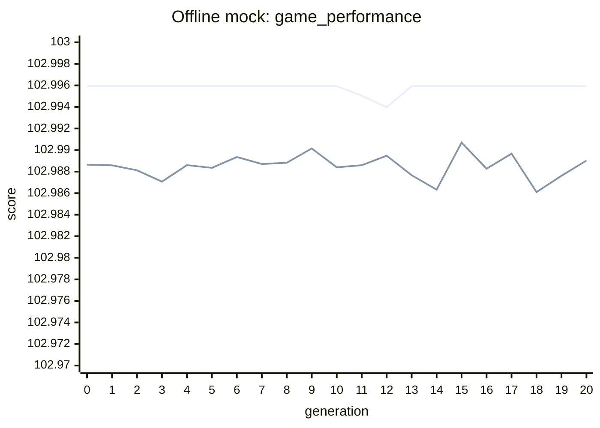
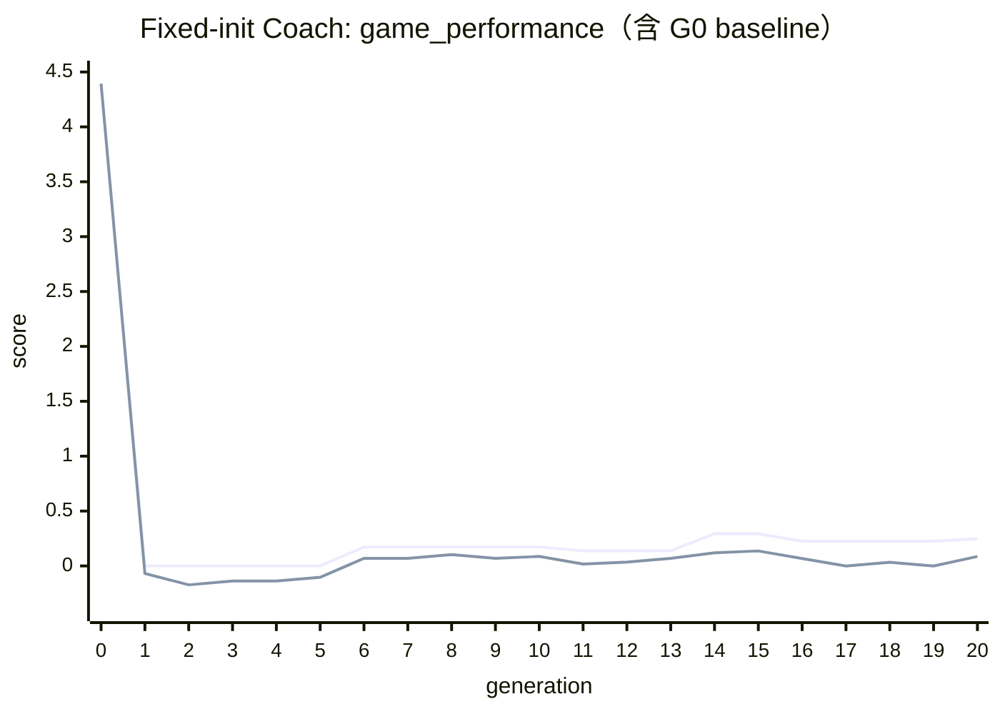
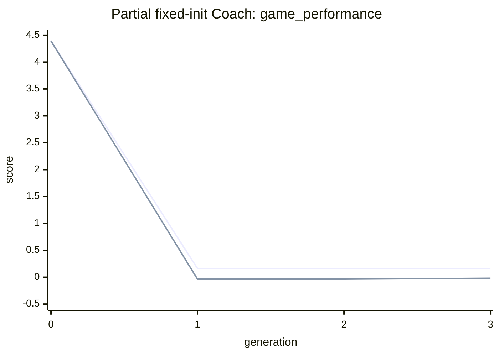

# 2026-10-16 最近實驗整理

## 摘要

本報告整理 2026-10-16 12:52–2026-10-17 02:01（Asia/Taipei）產生的 19 個 run。資料來源是每個 run 的 `manifest.json`、`config.yaml`、`timing.jsonl`、`summary.json` 與 `generations/generation_*.json`。

| 類別 | run 數 | 結果 |
|---|---:|---|
| framework bootstrap / JSON 產生失敗 | 10 | 都未進入演化 generation |
| offline mock baseline | 3 | 1 次完成 20 代、1 次中斷、1 次 artifact 驗證失敗 |
| fixed-init Coach | 5 | 1 次完成 20 代、1 次完成至 generation 3、3 次中斷/失敗 |
| single-machine Coach | 1 | 只完成 generation 0 後中斷 |

最重要的可用結果是：

1. `fixed_worker_combat_framework_offline_mock_20x10_seed8_1run` 完成 20 代，耗時 98.65 秒；但這是 deterministic offline mock，分數約 103，不能直接與真實 LLM run 的分數比較。
2. `fixed_worker_combat_framework_fixed_init_coach_20x10_seed8_1run` 的 [完整 run](../runs/20261016_164627_002786/manifest.json) 完成 20 代，使用 Qwen 3.5-9B，並成功使用遠端 LM Studio endpoint；耗時 33,300.38 秒（約 9 小時 15 分），generation 14/15 的最佳分數為 0.293370，generation 20 為 0.248307。
3. 真實 run 的 generation 0 是對 `passive` opponent 的初始化 baseline；generation 1 起改為 10 個 self-play opponent。故 generation 0 的 4.394159 與後續分數不在同一評估分布，不能視為一次突然的性能崩落。

## 共用實驗流程

除 bootstrap 失敗的 run 外，流程大致如下：

```text
讀取 resolved config
  → 載入固定 framework bundle 或執行 framework bootstrap
  → 建立 population=10 的初始候選
  → generation 0 評估（3 張地圖 × 3 rounds × 雙方換邊；每候選 180 matches）
  → 每代產生 mutation=10、依選擇結果進行 crossover
  → Java materialization → validation → compilation
  → self-play 評估；每 5 代刷新 opponent library
  → 寫入 generation artifact、timing 與 summary
```

共同設定為 20 generations、population 10、`reflection_operator_mode=static`、`java_materialization_mode=framework_slots`、self-play refresh interval 5。完整 population 評估通常是 10 候選 × 180 matches = 1,800 matches；generation 0 若只有 `passive` context，artifact 會記錄為 180 matches。

## 每次 run 明細

時間是 Asia/Taipei；耗時以 timing events 的最早開始至最晚結束計算。`G0–G20` 表示最後產生的 generation artifact，不代表該 run 一定成功完成目標代數。

| # | Run / 實驗 | 時間 | 耗時 | 狀態 / generation | 結果或停止原因 |
|---:|---|---|---:|---|---|
| 1 | [125251](../runs/20261016_125251_234426/manifest.json) `qwen3_5_9b_framework_coach` | 12:52:51–12:53:52 | 60.83 s | failed / — | Groq bootstrap 三次失敗：`mixBalanced` 非法 choice、429、canonical slot marker 不符。 |
| 2 | [131235](../runs/20261016_131235_392635/manifest.json) `qwen3_5_9b_framework_coach` | 13:12:35–13:14:56 | 140.93 s | failed / — | Groq bootstrap：schema 欄位/marker 錯誤，並受到 HTTP 413 payload too large。 |
| 3 | [132216](../runs/20261016_132216_007528/manifest.json) `qwen3_5_9b_framework_coach` | 13:22:16–13:22:30 | 14.09 s | failed / — | Groq HTTP 400：模型未產生可解析 JSON。 |
| 4 | [132806](../runs/20261016_132806_659361/manifest.json) `qwen3_5_9b_framework_coach` | 13:28:06–13:29:19 | 72.75 s | failed / — | Groq schema marker 錯誤，並受到 HTTP 413 payload too large。 |
| 5 | [134930](../runs/20261016_134930_273948/manifest.json) `qwen3_5_9b_framework_coach` | 13:49:30–13:53:02 | 212.32 s | failed / — | local Qwen bootstrap 三次都以 incomplete output 結束，沒有 `stop`。 |
| 6 | [140059](../runs/20261016_140059_819773/manifest.json) `qwen3_5_9b_framework_coach` | 14:00:59–14:04:31 | 212.06 s | failed / — | local Qwen 三次回應沒有 JSON text。 |
| 7 | [140748](../runs/20261016_140748_401093/manifest.json) `qwen3_5_9b_framework_coach` | 14:07:48–14:11:07 | 198.85 s | failed / — | local Qwen JSON 截斷，`Unterminated string`；前兩次也有 bundle 欄位錯誤。 |
| 8 | [141351](../runs/20261016_141351_166893/manifest.json) `qwen3_5_9b_framework_coach` | 14:13:51–14:18:15 | 264.51 s | failed / — | local Qwen 產生的 Java template 缺少大量 slot marker，最後 JSON 仍截斷。 |
| 9 | [144811](../runs/20261016_144811_251632/manifest.json) `qwen3_5_9b_framework_coach` | 14:48:11–14:48:11 | 0.34 s | failed / — | Mistral API HTTP 403。 |
| 10 | [145207](../runs/20261016_145207_489485/manifest.json) `qwen3_5_9b_framework_coach` | 14:52:07–14:52:11 | 4.00 s | failed / — | Mistral API HTTP 429。 |
| 11 | [145545](../runs/20261016_145545_964507/manifest.json) `offline_mock` | 14:55:45–14:55:49 | 3.37 s | failed / G0 | generation 0 建立後，`framework_bundle_sha256` 不是合法的 64 字元 lowercase SHA-256。 |
| 12 | [145716](../runs/20261016_145716_295035/manifest.json) `offline_mock` | 14:57:16–14:58:54 | 98.65 s | complete / G20 | 20 代全部成功；best `102.995936`，mean `102.989024`。 |
| 13 | [150124](../runs/20261016_150124_327816/manifest.json) `offline_mock` | 15:01:32–15:12:41 | 669.03 s | interrupted / — | 中斷於 generation artifact 產生前，無可用 generation metrics。 |
| 14 | [152019](../runs/20261016_152019_042289/manifest.json) `fixed_init_coach` | 15:20:19–15:27:28 | 429.09 s | interrupted / — | 中斷於 generation 0 完成前。 |
| 15 | [153826](../runs/20261016_153826_905394/manifest.json) `fixed_init_coach` | 15:38:27–16:15:30 | 2,223.32 s | interrupted / G3 | G0 只有 5/10 候選完成；G1–G3 完成 1,800 matches，best `0.162472`。 |
| 16 | [161600](../runs/20261016_161600_253541/manifest.json) `single_machine` | 16:16:00–16:17:45 | 105.02 s | interrupted / G0 | G0 完成 180/180 matches；best `4.805665`，尚不足以判斷收斂。 |
| 17 | [161825](../runs/20261016_161825_132918/manifest.json) `fixed_init_coach` | 16:18:25–16:28:34 | 608.87 s | interrupted / G0 | G0 僅 5/10 候選完成，90/180 matches。 |
| 18 | [163013](../runs/20261016_163013_442202/manifest.json) `fixed_init_coach` | 16:30:13–16:35:43 | 329.89 s | failed / — | generation 0 沒有任何候選完成 evaluation；這是修正 LM Studio JSON Schema 前的失敗 run。 |
| 19 | [164627](../runs/20261016_164627_002786/manifest.json) `fixed_init_coach` | 16:46:27–次日 02:01:27 | 33,300.38 s | complete / G20 | 真實 Qwen/Coach run 完成；best observed `0.293370`（G14–G15），final best `0.248307`。 |

## 收斂曲線與結果

### A. Offline mock baseline

此 run 的每代都完成 1,800/1,800 matches，沒有 failure。曲線幾乎是水平線，表示 deterministic mock 主要在驗證 pipeline、artifact 與演化流程是否能完整跑完，不是模型能力實驗。



| generation | best | mean | median | worst | generation time |
|---:|---:|---:|---:|---:|---:|
| 0 | 102.995936 | 102.988643 | 102.990131 | 102.976800 | 3.261 s |
| 5 | 102.995936 | 102.988349 | 102.988979 | 102.976800 | 6.960 s |
| 10 | 102.995936 | 102.988398 | 102.990921 | 102.976800 | 7.815 s |
| 15 | 102.995936 | 102.990699 | 102.991877 | 102.980774 | 6.918 s |
| 20 | 102.995936 | 102.989024 | 102.989176 | 102.980774 | 7.219 s |

### B. 真實 LM Studio/Qwen Coach run

`164627` 的流程是 local primary Qwen + remote LM Studio endpoint `http://192.168.1.136:1234/v1`，framework bundle 固定，Coach mutation 使用 LLM。generation 0 只評估 `passive`，generation 1 起評估 10 個 self-play candidates；因此曲線要分成 baseline 與 evolutionary phase 來看。



把 G0 拿掉後，曲線顯示：G1–G5 的 best 停在 0 附近，G6 起進入正分數區間；G14–G15 出現最高 best `0.293370`，之後回落但 G20 仍維持 `0.248307`。mean 在 G15 達 `0.136655`，G20 為 `0.085750`。這比較像「有改善但波動大、尚未穩定收斂」，不能宣稱單調收斂。

| generation | best | mean | median | worst | matches | generation time |
|---:|---:|---:|---:|---:|---:|---:|
| 0 (passive baseline) | 4.394159 | 4.394159 | 4.394159 | 4.394159 | 180/180 | 270.913 s |
| 1 | 0.000000 | -0.068920 | 0.000000 | -0.344602 | 1,800/1,800 | 2,467.726 s |
| 5 | 0.000000 | -0.103381 | 0.000000 | -0.344602 | 1,800/1,800 | 1,488.260 s |
| 10 | 0.172301 | 0.086667 | 0.172301 | -0.172301 | 1,800/1,800 | 1,425.003 s |
| 14 | 0.293370 | 0.118934 | 0.137841 | -0.206761 | 1,800/1,800 | 1,471.924 s |
| 15 | 0.293370 | 0.136655 | 0.137841 | -0.029549 | 1,800/1,800 | 1,431.765 s |
| 20 | 0.248307 | 0.085750 | 0.068920 | -0.098969 | 1,800/1,800 | 1,480.277 s |

主要耗時在每代 evaluation 與 LLM mutation。完整 run 的 generation time 中位數約 1,466.923 秒（24.45 分鐘），最慢是 G6 `2,494.012 s`；G20 的 breakdown 為 LLM request 821.843 s、evaluation 1,027.820 s、compilation 5.269 s。

### C. Fixed-init Coach 部分 run

`153826` 是最有用的 partial run：G0 因 5 個候選失敗只完成 90/180 matches，G1–G3 都完成 1,800 matches；G1 找到 best `0.162472`，G2 沒有改善，G3 mean 從 `-0.036084` 回升到 `-0.019246`。它支持「流程能進入 self-play，但早期候選生成/評估仍有失敗」的結論，不能當作完整收斂證據。



`161600` 的 single-machine run 只有 G0，best `4.805665`、mean `4.435310`，且 180/180 matches 完成；這個結果仍是 passive baseline，沒有 evolutionary curve。`161825` 的 G0 同樣只有 90/180 matches、5 個候選失敗。`163013` 直接因 G0 沒有候選完成 evaluation 而 failed。

## 時間與效率分析

| run | generation event 統計 | 觀察 |
|---|---|---|
| offline mock complete | 21 代，總 generation time 97.829 s，中位數 3.666 s | evaluation 約 3–7 s/代，沒有 LLM request；適合作為 pipeline smoke baseline。 |
| partial Coach `153826` | G0–G3 共 2,051.031 s，中位數 332.118 s | G1 為 1,332.734 s，evaluation 1,258.401 s，是早期 self-play/失敗重試的主要成本。 |
| single-machine `161600` | G0 105.025 s | evaluation 90.596 s，只有一個 baseline generation。 |
| complete real Coach `164627` | G0–G20 共 33,292.728 s，中位數 1,466.923 s | 每代約 23–42 分鐘；LLM mutation 與 1,800-match evaluation 共同主導時間。 |

完整 real run 的 artifact wall-clock span 是 33,300.381 s，與 generation events 的合計只差約 7.65 s，表示主要時間都已被 timing schema 捕捉。

## 結論與下一步

### 已確認

- pipeline、artifact、Java materialization、validation、compilation 與 180/1,800-match evaluation 在 offline mock 與完整 real run 都能跑完。
- LM Studio JSON Schema 相容性修正後，`164627` 的遠端 `qwen/qwen3.5-9b` request 成功，並完成完整 20 代；這是目前最可信的 end-to-end run。
- 早期失敗主要集中在 framework JSON 產生/驗證與 provider rate limit，不是 MicroRTS evaluation 本身。
- real Coach 的分數在 G6 後才持續出現正值，G14–G15 達到最佳；但 final generation 低於歷史 best，應報告為波動式改善而非收斂完成。

### 建議

1. 將 `164627` 的 20 代結果再以相同設定跑至少 3 個 seed，才可估計 Coach mutation 的平均效果與方差。
2. 對 generation 0（passive baseline）與 generation 1 以後（self-play library）分開畫圖、分開報告，不要把兩個分數尺度合成單一收斂結論。
3. 在下一批 run 保留每個 candidate 的 LLM request latency、failure category 與 opponent-wise score，優先分析 G1–G6 的高變異來源。
4. 若要比較 mock 與 real，應使用相同 opponent library、相同 scoring scale 的固定 evaluation，而不是直接比較 `102.99` 與 `0.29`。

## Artifact 索引

- [offline mock complete manifest](../runs/20261016_145716_295035/manifest.json) · [summary](../runs/20261016_145716_295035/summary.json) · [timing](../runs/20261016_145716_295035/timing.jsonl)
- [real Coach complete manifest](../runs/20261016_164627_002786/manifest.json) · [summary](../runs/20261016_164627_002786/summary.json) · [timing](../runs/20261016_164627_002786/timing.jsonl)
- [real Coach generation 20](../runs/20261016_164627_002786/generations/generation_0020.json)
- [partial Coach generation 3](../runs/20261016_153826_905394/generations/generation_0003.json)
