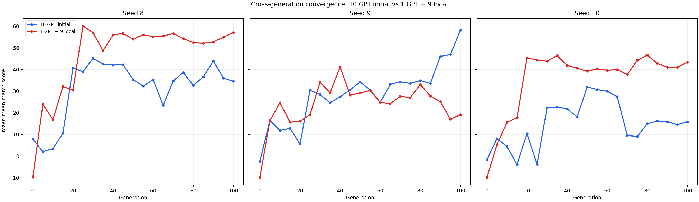
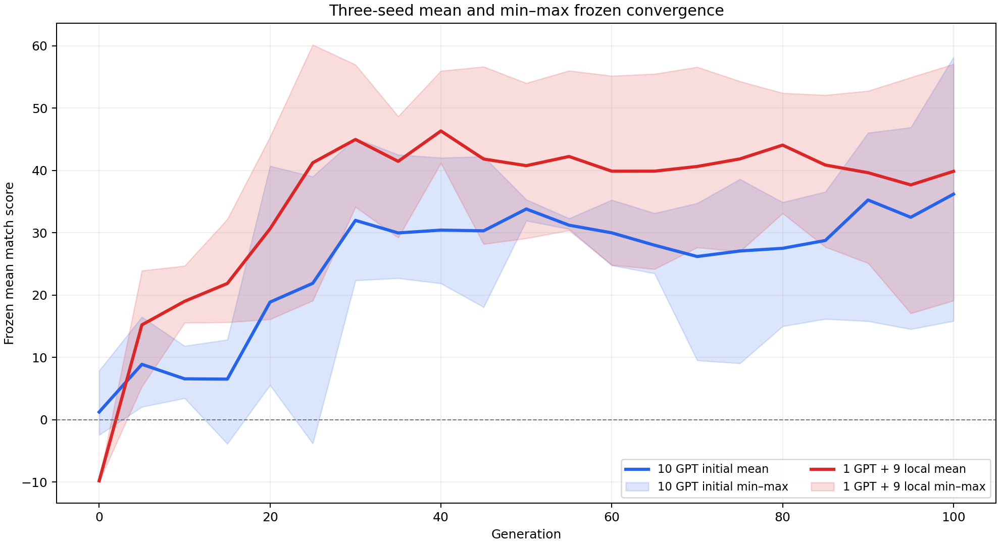

# 10 GPT initial vs 1 GPT + 9 local convergence

本比較使用同一套 immutable framework、同一個 seed、同一個 G0–G100 frozen evaluation protocol。比較對象是：

- **10 GPT initial**：2026-11 的 description-guided run，G0 的 10 個 genome 都由 GPT 選擇。
- **1 GPT + 9 local**：1030 ablation treatment 3，G0 只有 index 0 使用 frozen GPT genome，其餘 9 個是 seeded local genomes；後續兩者都使用相同 local evolution。

兩種方法的 framework bundle SHA-256 都是 `f674a580f0db088bd3436232d2dd36d071a231c9886f480a7aaed25669203e2b`。每個 checkpoint 都是 600 場 frozen matches，兩組共 84 個 checkpoint metrics，全部完成且無錯誤。

三個 seed 的平均與最大/最小範圍：

## Paired 結果

| Seed | Treatment | G0 | G100 | 最高 checkpoint | 最高 score | G100 win rate |
|---:|---|---:|---:|---:|---:|---:|
| 8 | 10 GPT initial | 7.89 | 34.56 | G30 | 45.16 | 65.5% |
| 8 | 1 GPT + 9 local | -9.66 | 57.06 | G25 | 60.16 | 76.3% |
| 9 | 10 GPT initial | -2.44 | 58.19 | G100 | 58.19 | 77.5% |
| 9 | 1 GPT + 9 local | -9.87 | 19.12 | G40 | 41.18 | 56.7% |
| 10 | 10 GPT initial | -1.71 | 15.84 | G50 | 31.94 | 56.5% |
| 10 | 1 GPT + 9 local | -36.78 | 5.84 | G25 | 18.16 | 51.0% |

## 結論

1. **沒有一致的 seed-level 優勢。** Seed 8 與 seed 10 是 1 GPT + 9 local 明顯較好；只有 seed 9 是 10 GPT initial 明顯較好。
2. **G0 起點方面，10 GPT initial 兩個 seed 都較高**：seed 8 高 `17.55`，seed 9 高 `7.43` frozen score。
3. **長期收斂方面，初始化效果受 stochastic trajectory 影響很大**：同一方法在 seed 8 與 seed 9 的最高 checkpoint、G100 表現和波動都不同。
4. 三個 seed 的 G100 平均：10 GPT initial `36.20`，1 GPT + 9 local `39.86`；因此加入 seed 10 後，平均結果反而略偏向 1 GPT + 9 local。
5. 比較適合的結論是：**10 GPT initial 穩定改善 G0 起點，但不保證後續收斂品質；應保留 frozen benchmark 的最佳 checkpoint，而不是固定使用 G100。**

## Source runs

- 10 GPT initial seed 8: [`20261105_153135_880565`](../runs/20261105_153135_880565/)
- 10 GPT initial seed 9: [`20261106_072846_805117`](../runs/20261106_072846_805117/)
- 10 GPT initial seed 10: [`20261107_135945_086651`](../runs/20261107_135945_086651/)
- 1 GPT + 9 local seed 8: [`20261101_211038_286628`](../runs/20261101_211038_286628/)
- 1 GPT + 9 local seed 9: [`20261102_131719_965893`](../runs/20261102_131719_965893/)
- 1 GPT + 9 local seed 10: [`20261103_043534_423377`](../runs/20261103_043534_423377/)
- [Comparison CSV](all_gpt_vs_one_gpt_convergence/comparison.csv)
- [Three-seed aggregate CSV](all_gpt_vs_one_gpt_convergence/three_seed_mean_min_max.csv)
- [Reproducible script](../scripts/compare_all_gpt_vs_one_gpt_convergence.py)
