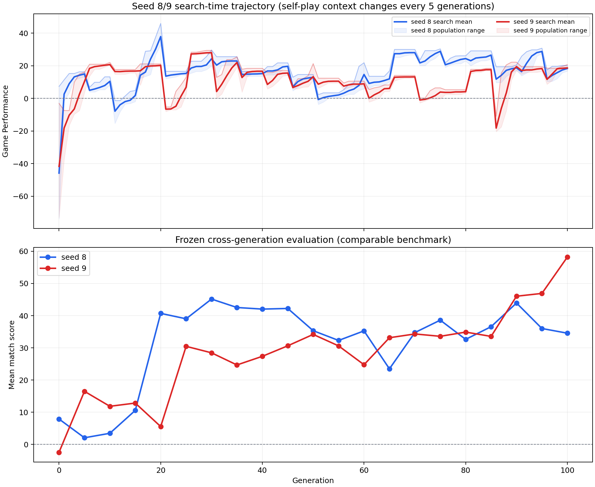

# Seed 8/9 convergence analysis

日期：2026-11-07（Asia/Taipei）

本分析比較 description-guided local evolution 的兩個完整 run：

| Seed | Run | 狀態 | 搜尋代數 | Fixed checkpoints |
|---:|---|---|---:|---:|
| 8 | [`20261105_153135_880565`](../runs/20261105_153135_880565/) | complete | G0–G100 | G0, G5, …, G100 |
| 9 | [`20261106_072846_805117`](../runs/20261106_072846_805117/) | complete | G0–G100 | G0, G5, …, G100 |

## 收斂圖

上圖的上半部是 search-time Game Performance；因 self-play pool 每 5 代刷新，這條曲線只能看作演化軌跡，不能直接當作跨代 benchmark。下半部是本次補跑的 frozen cross-generation evaluation：每個 checkpoint 重新選出該代最高的 runnable survivor，在同一套十 opponent、三地圖、每張地圖雙方各十場的 protocol 下完成 600 場。

## 主要結果

| 指標 | Seed 8 | Seed 9 |
|---|---:|---:|
| Fixed G0 mean match score | 7.89 | -2.44 |
| Fixed G100 mean match score | 34.56 | 58.19 |
| G0 → G100 改善 | +26.67 | +60.63 |
| Fixed 最高點 | G30: 45.16 | G100: 58.19 |
| G100 win rate | 65.5% | 77.5% |
| Search G100 population mean | 18.40 | 18.71 |

## 結論

1. 兩個 seed 都有跨代改善，但都不是單調收斂。Seed 8 在 G30 達到 frozen benchmark 高點後回落並波動；seed 9 在 G90–G100 才出現明顯後期提升。
2. Seed 8 的 G100 不是自己的最佳 checkpoint（34.56 < 45.16）；若以 frozen benchmark 選模型，應優先保留 G30。
3. Seed 9 的 G100 是最佳 checkpoint（58.19），且 G95 已達 46.91，顯示後期仍有有效進步，不能在 G50 左右宣稱收斂。
4. 兩個 seed 的 search-time G100 分數都約 18–19，但 frozen G100 分數分別為 34.56 與 58.19；這個差異說明 self-play fitness 與固定 benchmark 不可互換。
5. 因此已補上真正的跨代收斂實驗，不需要再開第三個 evolutionary run。後續報告應以 frozen curve 判定 checkpoint，並把 self-play curve 標為 search trajectory。

## Artifact

- Combined data: [`convergence.csv`](seed8_seed9_convergence/convergence.csv)
- Plot: [`seed8_seed9_convergence.png`](seed8_seed9_convergence/seed8_seed9_convergence.png)
- Seed 8 frozen result: [`fixed_evaluation_summary.json`](../runs/20261105_153135_880565/fixed_evaluation/fixed_evaluation_summary.json)
- Seed 9 frozen result: [`fixed_evaluation_summary.json`](../runs/20261106_072846_805117/fixed_evaluation/fixed_evaluation_summary.json)
- Reproducible analysis script: [`analyze_seed8_seed9_convergence.py`](../scripts/analyze_seed8_seed9_convergence.py)
